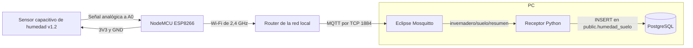

# Invernadero inteligente

Invernadero inteligente modular enfocado en cannabis medicinal. La primera etapa registra la humedad del sustrato para estudiar cómo cambia entre riegos y reunir datos para definir umbrales en la maceta.

La NodeMCU ESP8266 toma 15 grupos de 51 lecturas ADC repartidos en cinco minutos. Publica un resumen por MQTT con el promedio, la mediana de las medianas, el mínimo, el máximo y el rango. El receptor valida el mensaje y guarda una fila por ventana en PostgreSQL. El recorrido completo se verificó con una medición real.

## Conexión de los componentes



## Estructura

| Ruta | Contenido |
|---|---|
| [InvernaderoESP8266/](InvernaderoESP8266/) | Firmware y configuración de PlatformIO |
| [mqtt/](mqtt/) | Configuración local de Mosquitto |
| [Receptor/](Receptor/) | Suscriptor MQTT y esquema de PostgreSQL |

Puedes abrir [Invernadero.code-workspace](InvernaderoESP8266/Invernadero.code-workspace) en VS Code para ver las tres carpetas y usar PlatformIO en la misma ventana.

## Puesta en marcha en Windows

1. **PostgreSQL.** Crea la base `Invernadero` y ejecuta [esquema.sql](Receptor/esquema.sql) en ella si la tabla todavía no existe.
2. **Mosquitto.** En `mqtt/mosquitto-lan.conf`, ajusta la IP a la del PC en la red local. Desde `mqtt/`, crea el usuario `nodemcu` y arranca el broker. Ajusta las rutas si instalaste Mosquitto en otra ubicación.

   ```powershell
   & 'C:\Program Files\mosquitto\mosquitto_passwd.exe' -c .\mqtt-passwords nodemcu
   & 'C:\Program Files\mosquitto\mosquitto.exe' -c .\mosquitto-lan.conf -v
   ```

   Usa `-c` solamente al crear el archivo de contraseñas por primera vez.

3. **NodeMCU.** Copia `InvernaderoESP8266/include/credenciales.example.h` a `credenciales.h` en la misma carpeta. Completa los datos locales de Wi-Fi y MQTT. Si cambiaste la IP del broker, actualiza también `mqtt.setServer()` en `src/main.cpp`. Compila y carga el entorno `nodemcuv2` con PlatformIO.
4. **Receptor.** Desde `Receptor/`, crea el entorno de Python e inicia el proceso. Usa la IP local del paso 2. El programa pide las contraseñas de PostgreSQL y MQTT en la terminal.

   ```powershell
   python -m venv .venv
   .\.venv\Scripts\python.exe -m pip install -r requirements.txt
   .\.venv\Scripts\python.exe receptor_mqtt.py --broker '192.168.1.41'
   ```

   Cambia la IP del ejemplo por la IP local del PC. El receptor admite opciones para cambiar el host, el puerto y los usuarios mediante `--help`.

## Consultar las últimas mediciones

```sql
SELECT fin_ventana, cantidad_mediciones, promedio, mediana, minimo, maximo, rango
FROM public.humedad_suelo
ORDER BY fin_ventana DESC
LIMIT 10;
```

Los valores se conservan en unidades ADC. El receptor usa la hora de llegada al PC como fin de la ventana. Esta versión requiere que la NodeMCU, Mosquitto, PostgreSQL y el receptor estén activos. Los resúmenes que se pierden durante una desconexión quedan como huecos.

## Próximos pasos

- Registrar los eventos de riego y contrastarlos con la curva de secado.
- Mostrar en un dashboard las mediciones, los riegos y la hora de la última lectura.
- Validar los umbrales en la maceta antes de automatizar la bomba.
